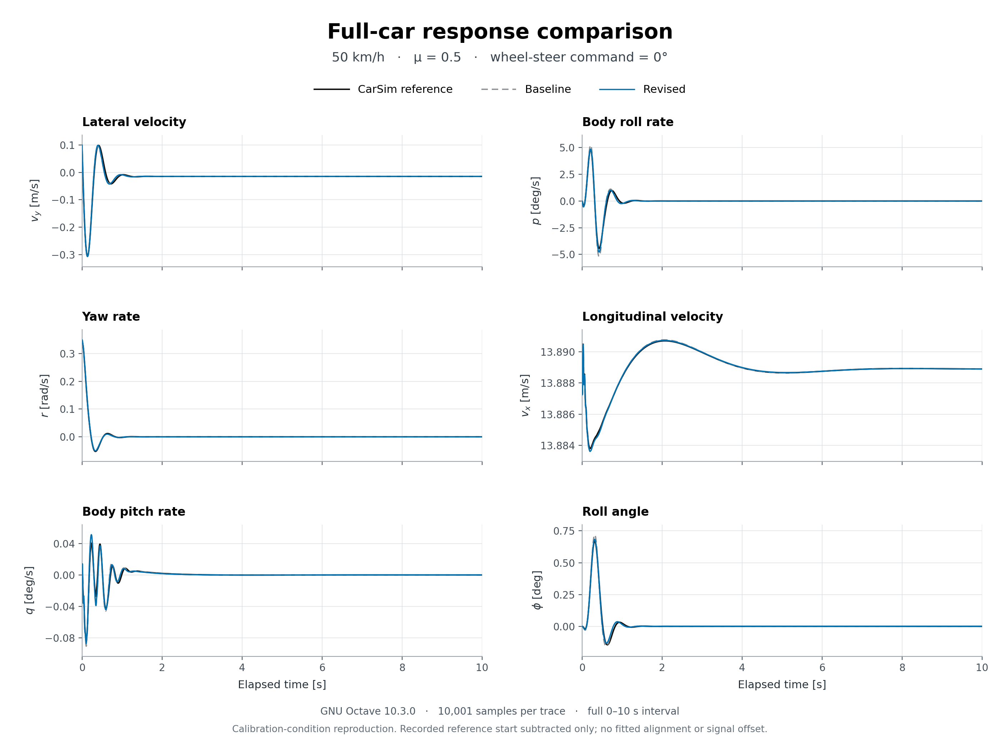
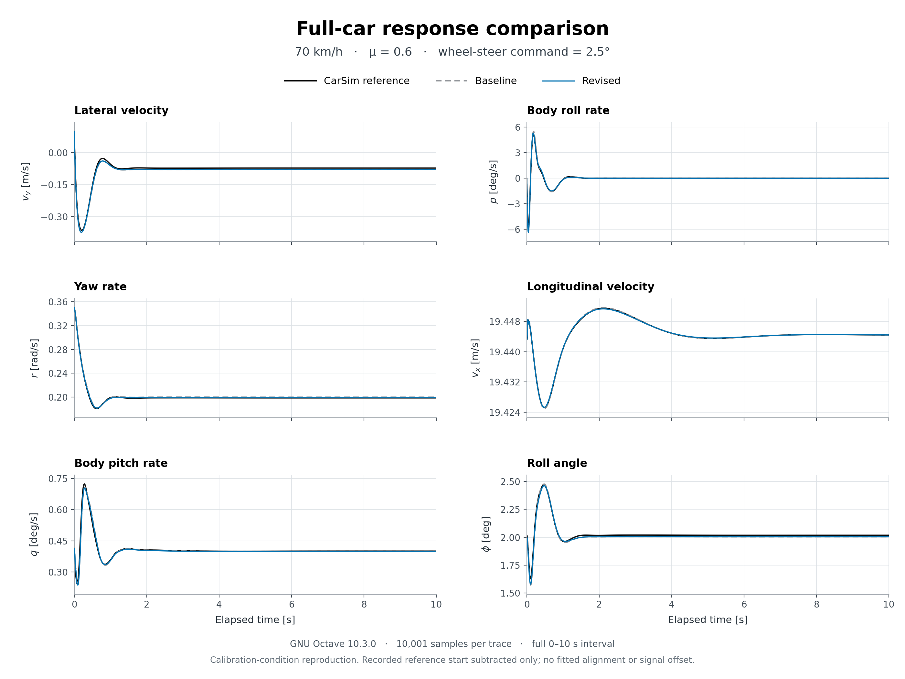
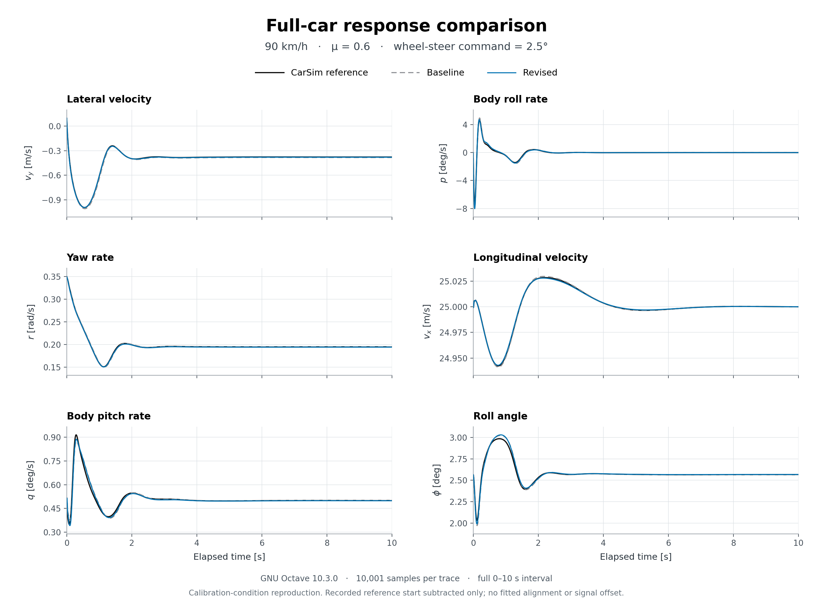

# CarSim 3조건 및 CSV 재현 검사

**3개 조건 × 6개 신호 = 18/18행 일치. 수치 검사 162/162개, 단위·표본 수·조건·논리값을 포함한 검사 252/252개가 통과했습니다.** 기존 모델과 수정 모델을 각각 10초 실행한 실제 응답에서 지표를 독립적으로 다시 계산했습니다.

| 속도 (km/h) | μ | 조향 명령 (deg) | 결과 |
| ---: | ---: | ---: | --- |
| 50 | 0.5 | 0 | 일치 |
| 70 | 0.6 | 2.5 | 일치 |
| 90 | 0.6 | 2.5 | 일치 |

50 km/h 원본 파일명에는 `0.6_2.5`가 적혀 있지만, 파일 내부 `info`는 μ=0.5·조향 0°입니다. 모든 조건은 원본 내부 메타데이터로 확인했으며, 이 조건은 제공 CSV와도 일치합니다.

| CSV와 비교한 지표 | 최대 절대차 |
| --- | ---: |
| 전체 구간 RMSE | 5.09e-15 |
| 구간별 RMSE | 1.09e-14 |
| 최대절대오차 | 7.55e-14 |
| RMSE 감소율 | 4.73e-10 percentage points |

판정 기준은 `abs(actual-expected) <= 1e-9 + 1e-5*abs(expected)`입니다. 모든 수치가 절대 허용오차 `1e-9` 이내에도 들어옵니다. 각 곡선은 0~10초의 10,001개 표본 전체를 사용했습니다. 구간별 RMSE는 `t<=2` 2,001개와 `t>2` 8,000개 표본으로 계산했습니다. 진폭 보정·맞춤 시간 이동·평활화·초기 과도 구간 제거를 하지 않았습니다.

- [재계산한 CSV](computed_metrics.csv)
- [기대값·실제값·차이·판정 상세](metrics_comparison_details.csv)
- [기계 판독용 검사 요약](metrics_comparison_summary.json)
- [기존·수정 모델의 6개 실제 MAT 결과](three_cases/)
- [사용자가 제공한 원본 MAT 및 기대 CSV](../../validation/reference_input/)

실행 환경은 **GNU Octave 10.3.0 + 제공된 C++ MEX 가속기**입니다. 원본 m-code와 native의 6개 대표 조건 동등성 검사 최대 scaled 차이는 `2.24e-14`로 허용값 `1e-7` 이내였습니다. 추가 마모 4패턴의 상태 미분·힘·초기 좌표 검사도 통과했습니다. 이는 Octave에서 두 구현을 비교한 결과이며 정식 MATLAB 실행 결과로 표시하지 않습니다.

이 비교는 제공 CSV에 표시된 보정 조건의 재현 확인입니다. 전체 1,050개 운전·마모 조건을 CarSim과 비교한 결과는 아닙니다.

## 비교 그래프

