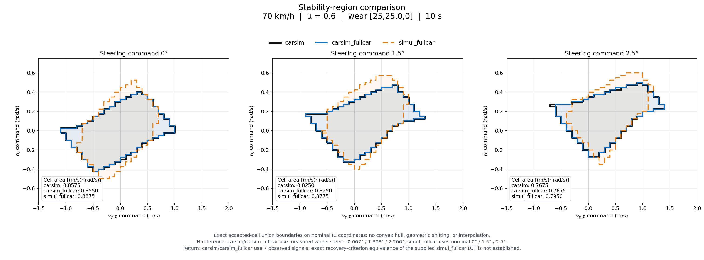

# 안정영역: 세 모델 비교

마모 **[25,25,0,0]**, 마찰계수 **0.6**, 속도 **70 km/h**, 조향 명령 **0°, 1.5°, 2.5°**의 안정영역을 비교했습니다. 이번에 새로 계산한 `carsim_fullcar` 영역은 이 세 조건입니다. 기존 `result/`의 1,050개 주행 결과와 전체 1,050조건 안정영역 계산은 서로 다른 작업입니다.



| 조향 명령 | carsim ↔ carsim_fullcar IoU | 차이 셀 | carsim ↔ simul_fullcar IoU |
| ---: | ---: | ---: | ---: |
| 0° | 99.7085% | 1 | 73.6318% |
| 1.5° | 100.0000% | 0 | 71.9697% |
| 2.5° | 99.3506% | 2 | 71.2329% |

IoU는 두 영역의 **교집합 면적 / 합집합 면적**입니다. 1.5°의 `carsim`과 `carsim_fullcar`는 저장된 셀 영역과 10초 통과 점이 모두 같습니다. 2.5°는 두 영역 모두 307셀이지만 셀 위치 두 곳이 다르므로 완전히 같지는 않습니다.

- `carsim`: 첨부된 세 개의 `RESEARCH2D_carsim*.mat`에 저장된 영역.
- `carsim_fullcar`: 기존 `result/` 1,050회를 생성한 **원래 34상태 HMC 모델**로 새로 계산한 영역. 모델·물리 데이터·보정·C++ 소스의 SHA-256을 원래 실행 서명과 대조했습니다. 실행 환경은 **GNU Octave 10.3.0 + C++ MEX**입니다.
- `simul_fullcar`: 새로 첨부된 `CDC_Stability_LUT_210.mat`에서 동일 조건을 추출한 다른 full-car 모델의 영역.

그림은 통과한 셀들의 실제 합집합 경계입니다. 표시용 convex hull, 이동 정렬, 보간은 적용하지 않았습니다. 가로축은 초기 횡속도 명령(m/s), 세로축은 초기 요레이트 명령(rad/s)입니다.

이는 **10초 동안 표본 시점의 조건을 만족하고 종단 구간에서 회복하는 유한 시간 영역**입니다. 불변 안정영역의 수학적 증명은 아닙니다. `carsim`/`carsim_fullcar`는 CarSim의 기록된 실제 전륜 조향각으로 만든 같은 H 기준을 사용하고, `simul_fullcar`의 H는 명령 조향각을 사용합니다. 또한 다른 LUT에는 완전한 종단 허용오차와 원시 궤적이 없어 세 모델의 판정 기준이 완전히 같다고 확인되지는 않았습니다. 따라서 이 그림만으로 순수한 차량 동역학 정확도 순위를 정할 수 없습니다.

## 파일

- [전체 비교 PNG](comparison/images/three_model_regions.png), [벡터 SVG](comparison/images/three_model_regions.svg)
- 개별 PNG: [0°](comparison/images/three_model_regions_0deg.png), [1.5°](comparison/images/three_model_regions_1p5deg.png), [2.5°](comparison/images/three_model_regions_2p5deg.png)
- [비교 수치 CSV](comparison/metrics/pairwise_metrics.csv), [독립 대조 JSON](comparison/audit/independent_audit.json)
- [계산·판정 방법](METHODS.md), [원래 모델 서명](physics_binding.json)
- `comparison/reference_input/`: 첨부 원본 다섯 파일과 입력 해시는 `comparison/input_manifest.json`에 보관.
- `comparison/reference_core/`: 비교에 필요한 그리드·마스크·메타데이터 추출본과 공통 H 매개변수.
- `comparison/carsim_fullcar/`: 새로 계산한 세 영역, 점·셀 판정 및 진단값.
- `comparison/context/`: 새 계산에 사용한 원래 모델 옵션·트림·물리 데이터·분류 옵션.
- `comparison/validation/`: 원래 계산과 새 영역 관측기의 동등성 검증, 실제 계산 로그.

## 재현

그림만 다시 만들려면 Python의 `numpy`, `scipy`, `matplotlib`을 설치하고 저장소 루트에서 실행합니다.

```sh
python stable_region/code/compare_regions.py
```

세 영역을 다시 계산하려면 먼저 저장소 루트의 원래 `hmc_mex`를 사용 중인 실행 환경에 맞게 빌드합니다. MATLAB에서는 `build_hmc_mex`를, GNU Octave에서는 C++17을 사용하는 `mkoctfile --mex`를 사용합니다. 이후 저장소 루트에서 다음을 실행합니다.

```matlab
addpath(pwd);
addpath('stable_region/code');
build_stable_region_mex;
prepare_three_contexts;
run_carsim_fullcar_region('0');
run_carsim_fullcar_region('1p5');
run_carsim_fullcar_region('2p5');
```

영역 MEX는 C++17/OpenMP 도구 체인이 필요합니다. 공개 빌드 함수의 MATLAB 분기는 제공하지만 이 작업에서 MATLAB 실행 검증은 하지 않았습니다. 기존 체크포인트와 실행 바이너리·초기 상태·분류 옵션이 다르면 재사용을 거부합니다.
